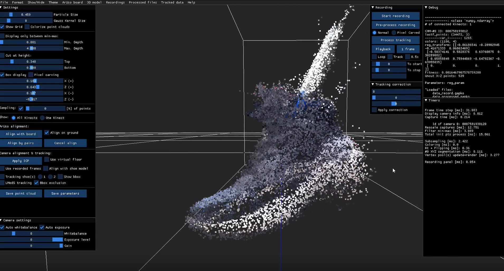

{}

## Contexte

Les physiothérapeutes ont besoin d’un **modèle 3D des pieds** en début de séance pour affiner l’analyse de la marche, le diagnostic et le traitement. Aucun outil n’est assez rapide, fiable et simple pour la routine clinique : les applications testées (MagiScan, Kiri Engine, Qlone, Scandy Pro, Myfit) sont trop lentes, imprécises ou coûteuses4.

Ce projet est une **étude de faisabilité** (environ 250 h) : choisir la technique de reconstruction la plus adaptée en temps et en précision, et vérifier qu’un smartphone peut remplacer la caméra de profondeur.

<--->

*Prototype Kinect : nuage de 34 472 points d'une chaussure.*

{}

{}

## Objectifs

- Modèle 3D des deux pieds **en moins de 5 minutes**, patient·e allongé·e sur une table ;
- voûte plantaire, cheville, avant-pied et arrière-pied ;
- reconstruction **incrémentale** : chaque nouvelle image complète le modèle ;
- à terme, acquisition par **smartphone**, sans câble.

## Méthodologie

Trois techniques comparées en temps de calcul et en précision, sur des données d'exemple (pas sur des pieds) :
- **SAM / MCC** (Meta)1 : 1 image en 3 min 32 ; nuage de points sans maillage ; le réseau complète les parties cachées et peut ajouter un orteil absent.
- **Reality Scan** (Epic Games) : 17 photos en 3 min 24 ; calcul sur serveur ; non incrémental, chaque photo ajoutée relance le calcul.
- **KinectFusion**2 (recalage ICP, fusion TSDF) : 571 images RGB-D3 en 32 s, soit 18 images/s ; produit un maillage.

KinectFusion est retenu : seule technique rapide et incrémentale.

## Technologies

  
  
  

<--->

## Résultats

Prototype Python + GeeXLab avec une Kinect, testé sur une chaussure :
- 4 images/s, recalage ICP en 200 ms par image.
- 34 472 points après 40 s d'acquisition.
- Bruit visible, sortie en nuage de points, sans maillage.

## Limites et perspectives

- Atteindre au moins 10 images/s (optimiser l'ICP) et filtrer le bruit.
- Générer le maillage en 1 à 2 minutes, en un clic.
- Tester sur des pieds.
- Remplacer la Kinect par un smartphone (ARCore Depth API, envoi par HTTP) : non testé, l'application d'exemple ARCore était incompatible.
- Concevoir l'interface avec les physiothérapeutes.

## Partenaires

Chèque d'innovation **Innosuisse** (janvier à mars 2024) pour **O2TE Sàrl**, chef de projet **Christophe Otte**, physiothérapeute.

{}
