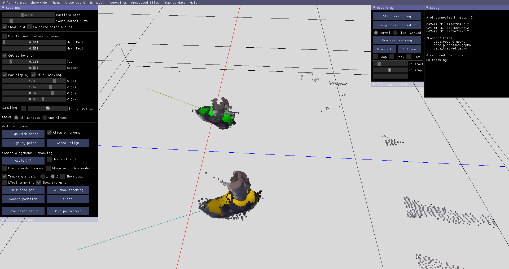

{}

## Contexte

La capacité de marcher est essentielle à la **qualité de vie**. De nombreuses atteintes musculo-squelettiques et neurologiques l’affectent et nécessitent une prise en charge lourde et onéreuse.

Les connaissances obtenues en laboratoire peinent à être appliquées en clinique : les systèmes d’analyse de la marche y sont **onéreux, complexes et parfois invasifs**.

## Objectifs

Les caméras **RGB-D** sont des capteurs « orientés patients », abordables et simples à mettre en œuvre, utilisables jusqu’au domicile.

Concevoir un **système multicaméras RGB-D markerless**, déployable à grande échelle, suffisamment précis pour mesurer en clinique les paramètres spatiotemporels et cinématiques de la marche.

<--->

## Partenaires

Projet financé par la **HES-SO**, en étroite collaboration avec le **Swiss BioMotion Lab du CHUV**, un des leaders mondiaux de l’analyse et du réentraînement de la marche.

{}

{}

## Résultats

Une solution de capture et d’analyse du mouvement **abordable, simple à utiliser et sans contact**.

Une première validation a été conduite dans le cas de l’**arthrose du genou** avec le Swiss BioMotion Lab du CHUV, ouvrant la voie à un transfert vers les patients et le marché.

<--->

## Perspectives

- Troubles musculo-squelettiques ;
- entraînement sportif ;
- jeux vidéo ;
- VR/AR pour la conception et la maintenance industrielle.

{}
