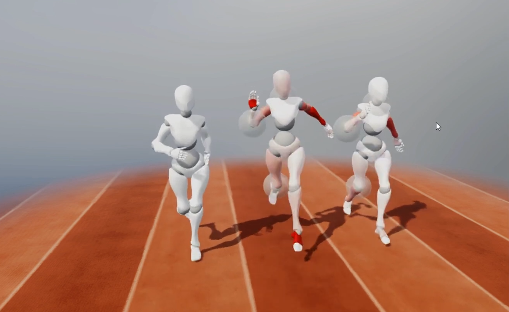
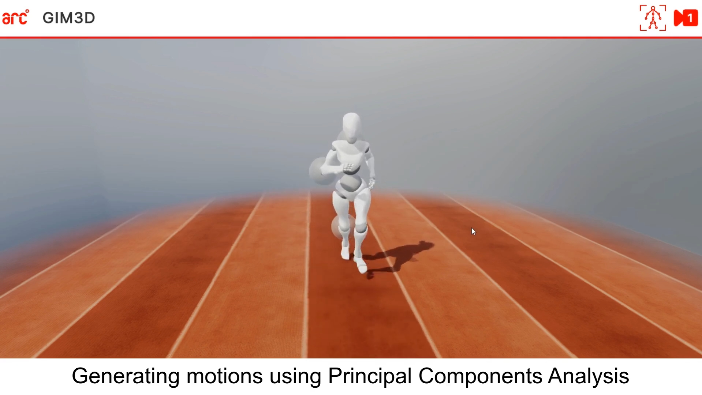

{}

## Contexte

En sport, en rééducation ou en prototypage virtuel, il est essentiel de communiquer des informations de mouvement **rapidement, intuitivement et sans ambiguïté**.

Pour les entraîneur·es, transmettre aux athlètes des **ajustements précis** de leur geste reste un défi : descriptions verbales et vidéos sont souvent insuffisantes.

## Objectifs

- Montrer directement à l’athlète le mouvement à corriger ;
- créer et afficher des mouvements 3D **de manière intuitive et rapide** ;
- s’appuyer sur des **modèles statistiques avancés** pour garantir des mouvements plausibles.

<--->

{}

{}

## Résultats

Étude pilote avec 5 participant·es1 :
- forte volonté d’utiliser l’outil (**F-SUS = 85,5**) ;
- UEQ-S : moyenne globale de **2**, qualité pragmatique (2,35) supérieure à la qualité hédonique (1,65) ;
- outil jugé utile, clair et efficace.

<--->

## Partenaires

Projet financé par la **HES-SO** et développé avec l’**Institut HumanTech (HEIA-FR)** et le **Swiss BioMotion Lab (CHUV)**.

Les premiers résultats démontrent l’efficacité et la plausibilité des mouvements générés, pour les praticien·nes comme pour les chercheur·euses.

{}
