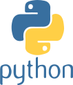

{}

## Contexte

L’arthrose du genou touche **8,5 % de la population suisse**1 pour un coût supérieur à 20 milliards CHF/an2.

La pratique physiothérapeutique recommande une **approche individualisée** à chaque patient3.

La capture de mouvements 3D (MoCap) permet d'optimiser des métriques biomécaniques comme le moment d’adduction du genou (**KAM**), directement lié à la progression de la maladie4.

## Motivations
1. Permettre aux physiothérapeutes de visualiser l’impact des styles de marche sur le KAM.
2. Utiliser un **avatar 3D** comme **moyen de communication**, plutôt que des courbes et des graphiques.
3. Proposer des **contrôles intuitifs** (écartement des pieds, balancement du tronc, etc.) permettant aux thérapeutes de proposer un traitement individualisé.

## Méthodologie

Mise en place d’une **boucle collaborative temps réel** entre les patient·es et les physiothérapeutes :
- les patient·es équipé·es de marqueurs marchent sur un tapis roulant avec capteurs de force;
- les physiothérapeutes observent le KAM et explorent divers styles de marche via des critères sémantiques;
- des modèles d’IA génératives spécialisés génèrenet les mouvements cibles en respectant les critères spécifiés;
- ces mouvements cibles sont reproduits sur un avatar 3D affiché aux patient·es sur un écran.

Un entrainement incrémental des modèles génératifs spécialise les mouvements générés à un·e patient·e donné·e, reflétant son style de marche et proposant une cible individuelle réaliste et atteignable.

## Technologies

  
  
  

<--->

## Impact & résultats attendus

Ce projet allie pour la première fois l’approche personnalisée des physiothérapeutes aux métriques biomécaniques mesurées en laboratoire.

3 études feront l’objet de publications :
- 1 étude clinique (22 patient·es) analysant l’impact des stratégies de marche sur le KAM;
- 1 étude (3 physiothérapeutes) évaluant si le système permet de générer des mouvements de marche de façon intuitive;
- 1 étude (20 patient·es) validant que les patient·es comprennent les instructions et parviennent à modifier leur marche.

Les publications seront en accès libre et le code source sera mis à disposition de la communauté scientifique.

IGR3D s’appuie sur **GIM3D** (2024-2025, HES-SO) et sur **Motion Machine** (Master HES-SO d’Antoine Lestrade).

## Partenaires

Projet financé par le **FNS** (2026-2030) et mené avec la **HESAV** et le **CHUV**.

{}
