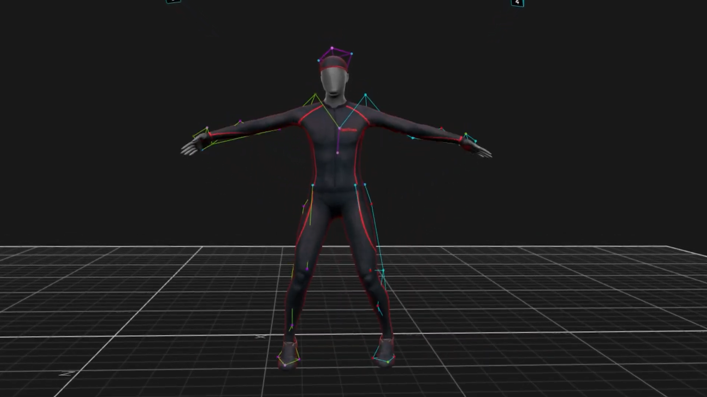

{}

## Mission

Nous mesurons, analysons et générons du mouvement humain en 3D pour la santé et le sport.

**Domaines :** rééducation, sport, ergonomie, animation 3D, réalité virtuelle, création artistique.

## Équipement
- **16 caméras OptiTrack** (2,2 MP) : une mesure toutes les 2,8&nbsp;ms
- **Volume de capture** : 50 m2
- **6 capteurs Azure Kinect DK**
- **1 tapis de course** **Maxxus runMaxx 9.1**

<--->

{}

{}

## Projets de recherche

#### IGR3D (2026-2030, FNS)
Un avatar 3D guide la rééduction de la marche pour les patient·es atteint·es d’arthrose du genou.
  - L’arthrose du genou touche 8,5 % de la population suisse1 et coûte plus de 20 milliards CHF par an2.
  - 3 études : 22 patient·es, 3 physiothérapeutes, 20 patient·es.
  - Publications en accès libre et code source ouvert.

#### GIM3D (2024-2025, HES-SO)
Un entraîneur modifie une foulée de course en 3D pour montrer la correction à son athlète.
Étude pilote avec 5 participant·es : score d’utilisabilité F-SUS de 85,53.

#### Foot 3D Scan (2024, Innosuisse)
Scan 3D des pieds en moins de 5 minutes pour les physiothérapeutes et les podologues, avec un scanner 3D portable et markerless.

#### GAPKO (2023, HES-SO)
Analyse de la marche sans marqueurs, par caméras RGB-D, pour la pratique clinique.

## Technologies

  
  
  
  

<--->

## Projets d'étudiants

#### Python Skeletal Animation, Travail de Bachelor (2022-2023)
Bachelor de Dimitri Kohler : une bibliothèque Python de traitement de MoCap, point de départ du projet de recherche GIM3D.

#### Motion Machine, Travail de Master (2025)
Master HES-SO d'Antoine Lestrade.
Réalisé pendant GIM3D ; ses résultats sont utilisés dans IGR3D.

#### Dagster pour les animations 3D, travail de semestre (2025)
Flux d’orchestration local pour la gestion automatisée des données de capture de mouvements.

#### FishTank UE5 (2026)
Suivre la tête en temps réel pour adapter la perspective dans Unreal Engine 5.

#### Base de données MoCap
Indexer et rechercher les fichiers de mouvement du labo.

#### Vignettes 3D
Créer des GIF animés à partir de fichiers BVH.

## Démos en direct

- Tennis de table en capture de mouvement.
- GIM3D : modifier un mouvement 3D en direct.

{}

{}

{}
