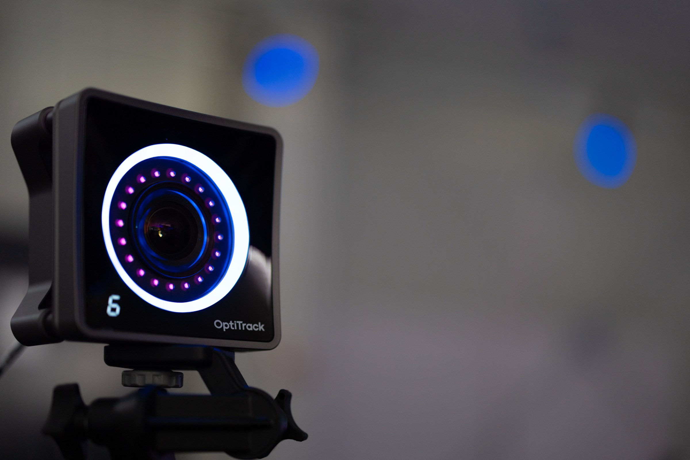
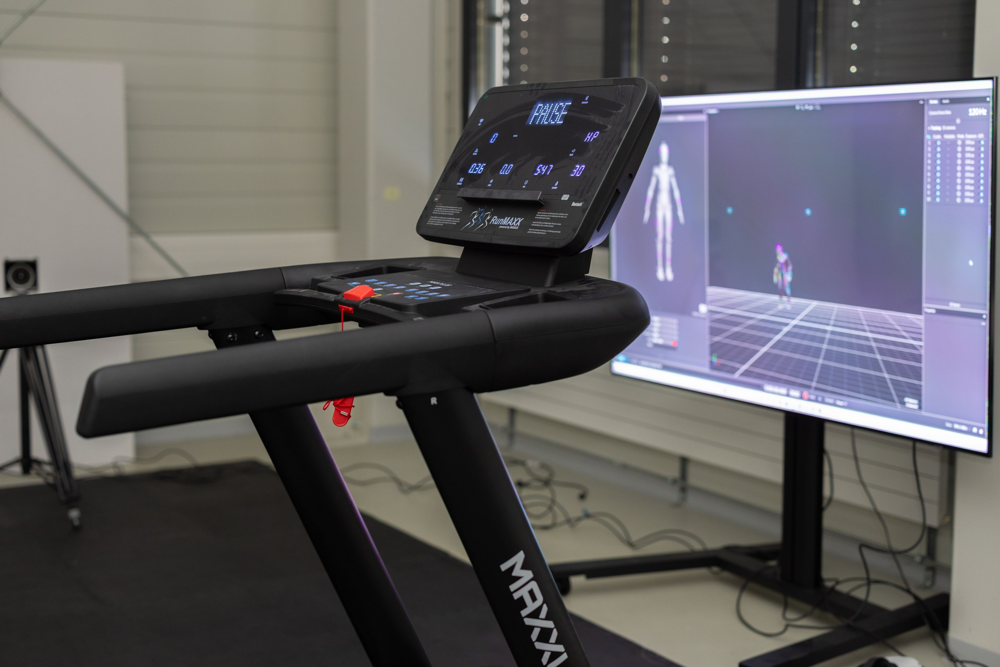

{}

## Mission

Le Motion-Lab @ HE-Arc est un environnement de pointe dédié à la **capture 3D du mouvement humain**.

Il fournit des solutions innovantes pour l’étude du mouvement dans divers contextes : **sport, rééducation, ergonomie, animation 3D et réalité virtuelle**.

## Équipement

- **16 caméras OptiTrack** (2,2 MP, 360 fps)
- **6 capteurs Azure Kinect DK**
- un casque **HoloLens 2**
- un tapis de course **Maxxus runMaxx 9.1**

<--->

{}

{}

## Recherche appliquée

Projets interdisciplinaires réunissant chercheur·euses, clinicien·nes, ingénieur·es et artistes :
- analyse biomécanique et rééducation ;
- modélisation 3D du geste sportif ;
- avatars réalistes pour les environnements virtuels ;
- reconstruction et simulation temps réel de mouvements humains complexes.

<--->

## Expertise & services

- Acquisition et traitement de données de mouvement 3D ;
- outils logiciels de visualisation et d’interprétation des gestes ;
- intégration de la MoCap dans des chaînes de production 3D ou de réalité mixte ;
- conseil et formation en capture de mouvement et reconstruction 3D.

**Contact :** Prof. Benoit Le Callennec, responsable du Motion-Lab @ HE-Arc.

{}
