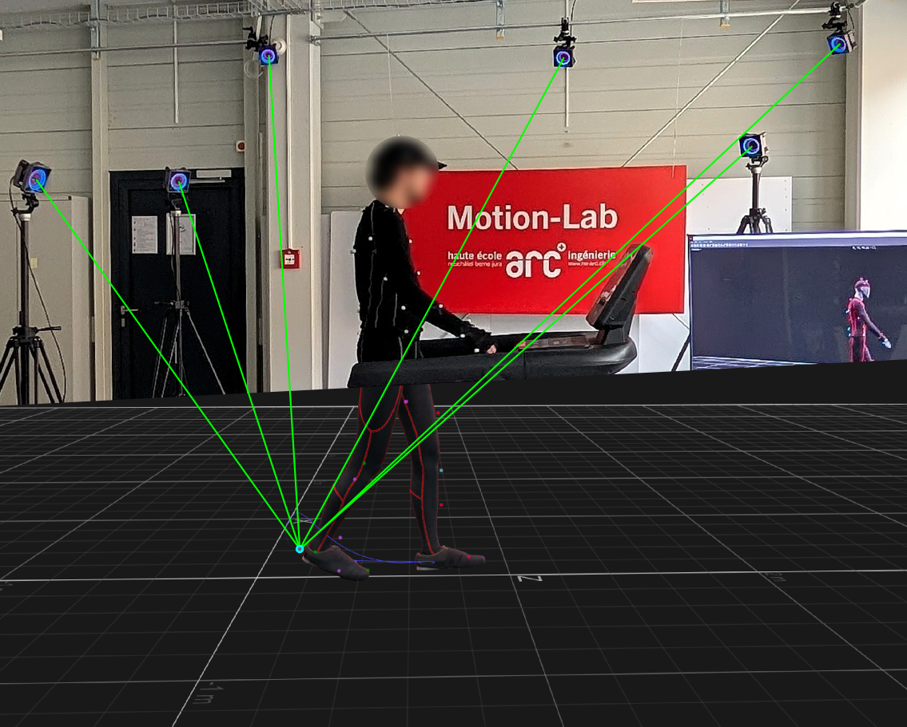
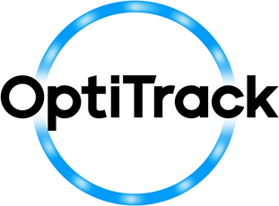

{}

## Mission

Nous mesurons, analysons et générons du mouvement humain en 3D pour la santé et le sport.

**Domaines**

Rééducation, sport, ergonomie, animation 3D, réalité virtuelle, création artistique.

## Équipement
- **16 caméras OptiTrack** pour une mesure temps réel et précise du mouvement humain en 3D
- **Volume de capture** : 50 m2
- **6 capteurs Azure Kinect DK** pour la capture de mouvement markerless
- **1 tapis de course** **Maxxus runMaxx 9.1**

<--->

{}

{}

## Projets de recherche

#### IGR3D (2026-2030, FNS)
Un avatar 3D guide la rééducation de la marche pour les patient·es atteint·es d’arthrose du genou.
  - L’arthrose du genou touche 8,5 % de la population suisse1 et environ 654 millions de personnes de 40 ans et plus dans le monde2.
  - 3 études : ~40 patient·es, 3 physiothérapeutes.
  - Publications en accès libre et code source ouvert.

#### GIM3D (2025, HES-SO)
Un entraîneur modifie une foulée de course en 3D pour montrer la correction à son athlète.
Étude pilote avec 5 participant·es : score d’utilisabilité F-SUS de 85,53.

#### Foot 3D Scan (2024, Innosuisse)
Étude de faisabilité d’un scan 3D des pieds pour les physiothérapeutes. Objectifs : moins de 5 minutes, avec un scanner 3D portable et markerless.

#### GAPKO (2022, HES-SO)
Capture de la marche markerless (Kinect).

## Technologies utilisées

  
  
  
  

<--->

## Projets d’étudiants

#### Python Skeletal Animation (2022-2023)
Travail de Bachelor de Dimitri Kohler.
Conception d’une bibliothèque Python de traitement de MoCap, point de départ du projet de recherche GIM3D.

#### Motion Machine (2024)
Travail de Master HES-SO d’Antoine Lestrade.
Conception d’un système de streaming d’animations 3D avec cinématique directe et Motion Matching.
Résultats utilisés pour IGR3D.

#### Dagster pour les animations 3D (2025)
Projet de semestre.
Flux d’orchestration local pour la gestion automatisée des données de capture de mouvements 3D avec Dagster.

#### FishTank UE5 (2026)
Travail de Bachelor.
Suivi de la tête en temps réel pour adapter la perspective dans Unreal Engine 5.

## Démos en direct

- Tennis de table en capture de mouvement.
- Suivi de la tête en temps réel avec effet stéréoscopique.
- GIM3D : modifier un mouvement 3D en direct.

{}
