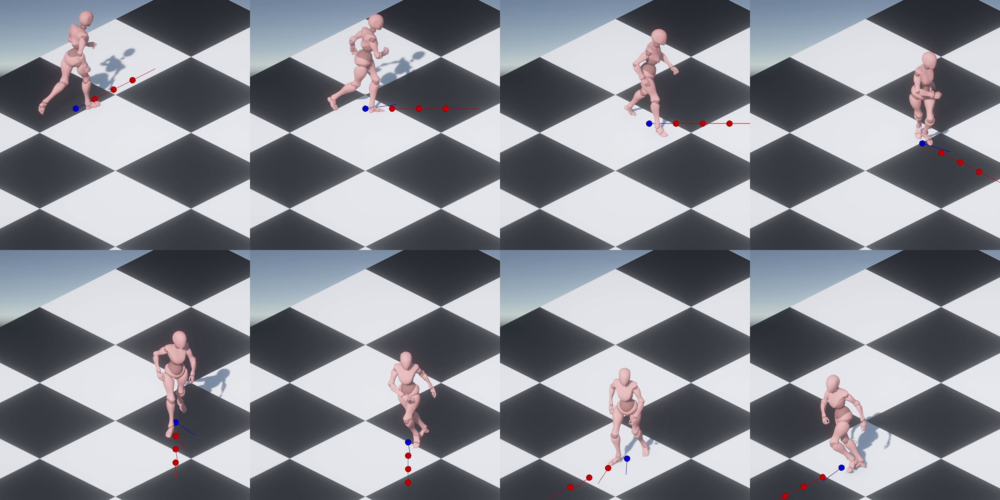

{}

## Contexte

Animer des personnages 3D est **long et complexe** : éditeurs d’animation, outils de capture de mouvement, moteurs de jeu et systèmes d’animation se succèdent. Le **manque d’interopérabilité** entre ces outils (formats de données, plateformes) complique le travail.

Les systèmes d’animation reposent sur de **grandes collections d’animations**, souvent issues de la capture de mouvement. Les graphes d’animation faits à la main deviennent difficiles à maintenir. Le **Motion Matching**1 automatise les transitions, mais demande beaucoup de calcul et de mémoire, en temps réel.

Le cloud permet de **déporter ce calcul sur un serveur** et de diffuser l’animation en direct.

<--->

*Personnage piloté par Motion Matching, diffusé en streaming dans Unity.*

{}

{}

## Objectifs

- Un **serveur de streaming d’animations** piloté par une **API REST**, avec plusieurs animations diffusées en même temps ;
- des **algorithmes d’animation** (« animateurs ») prêts à l’emploi, chacun livré comme package Python ;
- un **plugin Unity** pour se connecter au serveur, piloter l’animation et l’appliquer aux personnages ;
- intégrer Motion Machine à d’autres projets de recherche, comme **GIM3D** et ses algorithmes ACP et VAE.

## Méthodologie

- **Serveur Python** basé sur **FastAPI** ; animations diffusées par **WebSocket**.
- **Lecture d’animation** en cinématique directe (FK), basée sur la librairie **Skanym** du projet GIM3D.
- **Motion Matching** en Python, d’après Clavet1, pour des transitions fluides et réalistes entre animations.
- **Plugin client Unity** : contrôle du serveur et des paramètres des animateurs.

## Technologies

  
  

<--->

## Résultats

- Système **multiplateforme** de streaming d’animations 3D en temps réel2.
- **3 animateurs** intégrés : lecture d’animation (FK), Motion Matching, animateur ACP de GIM3D.
- Animations ACP de **GIM3D** calculées sur le serveur et diffusées dans Unity.
- Recherche de la meilleure pose (Motion Matching), pour 13 184 poses : **845 ms** en objets Python, **93,7 ms** avec Numpy, **3,4 ms** avec Numba, **1,16 ms** avec Numba en parallèle.

## Limites et perspectives

- Compatible aujourd’hui avec **Unity** seulement.
- Extension prévue à d’autres outils et moteurs : **Blender**, **Unreal Engine**, **Godot**.
- Optimisations à l’étude, comme la **parallélisation**, pour la montée en charge et les performances du Motion Matching.

## Partenaires

Travail de Master **MSE HES-SO**, en collaboration avec **Stade Lausanne Athlétisme**. Expert : Alexandre Serex (**Quantic Dream**).

{}
